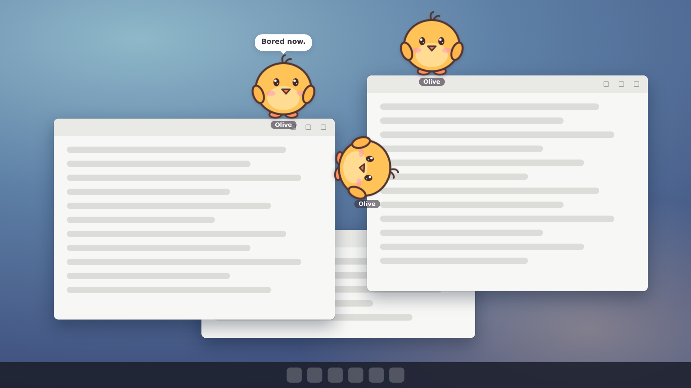

# Desktop Buddies

Little characters that live on your Windows desktop. They walk along your windows, climb the sides, hang underneath, nap, chat and get thrown about. Make your own from one picture or a full set of poses, or bring in a Shimeji folder.



Free and open source, for Windows 10 and 11. No buddies come with it: make one, open a `.buddy` file someone shared, or bring in a Shimeji folder. [CHANGELOG.md](CHANGELOG.md) says what's in each version.

## Download
From [the latest release](https://github.com/exvanitas/desktop-buddies/releases/latest):

- **Installer:** `desktop-buddies-X.Y.Z-setup-x64.exe`. Installs for you alone, with no admin prompt, and adds Desktop Buddies to the Start menu.
- **Portable zip:** `desktop-buddies-X.Y.Z-windows-x64.zip`. Unzip the whole folder somewhere you'll keep it, and run `desktop-buddies.exe` with the `app` folder beside it.
- **winget** (coming soon): `winget install --id exvanitas.DesktopBuddies -e`

The downloads aren't signed. Windows may say "Windows protected your PC": click More info, then Run anyway. With Smart App Control on, Windows may block a new version outright. Please don't turn it off for this.

[docs/install.md](docs/install.md) has the rest: WebView2, updating, removing, and where your buddies are kept.

## Using it
- **The Manager** opens on first start, and from the tray icon near the clock. Call buddies out and send them home, call more copies, and import, export or delete them. Settings can keep buddies off windows or off one program, and start the app with Windows.
- **On the desktop,** one world spans all your monitors. Buddies walk on your windows and ride along when you move one. Drag them, throw them, and right-click one to give her a treat, have her chase your mouse, or call another copy.
- **The Maker,** from New buddy in the Manager, makes a buddy from one picture or a full set of poses. Write what she says for each mood and moment, set how she sits on floors, walls and ceilings, and try her out on your screen. Pip, the sample, shows what a full set can do.
- **Sharing:** a buddy is one `.buddy` file. Export her from the Manager, and Import adds one.
- **Shimeji:** Import takes a Shimeji folder and makes a buddy of it.

## Community
Ask questions, report bugs and show off your buddies on the Milliways Discord server: [discord.gg/HNhFu4bDNj](https://discord.gg/HNhFu4bDNj). Desktop Buddies has its own channel there, #desktop-buddies. Report bugs in #orders, tagged desktop-buddies. [GitHub issues](https://github.com/exvanitas/desktop-buddies/issues) work too.

## For other apps
A local API, off until you turn it on in Settings. Then apps and AI agents on your PC can ask buddies to wave or say a short line, after you allow each app in the Manager. Nothing outside your PC can reach it. An MCP server for it is in [tools/mcp](tools/mcp). [docs/local-api.md](docs/local-api.md) has the details.

## Privacy and security
Desktop Buddies' own code sends nothing anywhere: no accounts, ads, analytics, update checks or telemetry, in the app, the Maker or a page it exports. To use your windows as terrain it reads which windows are open, where they are, their order and states, and which program each belongs to, never their titles or contents, and none of it leaves your PC. It draws its windows with Microsoft Edge WebView2, which follows Windows' own diagnostic data and update settings. [PRIVACY.md](PRIVACY.md) and [SECURITY.md](SECURITY.md) have the details.

## Build from source
You need Node 22 and pnpm 10. The exe also needs Rust and Windows; the app folder builds anywhere.

```
pnpm install
pnpm dev            # the web Maker, with live reload
pnpm build          # apps/maker/dist, and apps/desktop/dist/app
```

The exe is in `apps/desktop/src-tauri`: run `cargo build --release` there, on Windows, and put `apps/desktop/dist/app` beside it as `app`. [apps/desktop/README.md](apps/desktop/README.md) has its flags and how the pieces fit. The web Maker is the same Maker in a browser, and can export a page with your buddies on it.

## Contributing
Issues and pull requests are welcome. Before a pull request, run the checks:

```
pnpm typecheck
pnpm test             # includes the golden traces
pnpm test:browser     # headless, on the builds
pnpm test:manager     # headless, the Manager on the real hub and a fake exe
pnpm test:maker-view  # headless, the Maker's view
```

The browser checks use a Chromium that's already installed: set `CHROME_PATH`, or they look in Playwright's cache. The golden traces in `apps/maker/tests/golden` record what the engine painted, frame for frame, and they're never re-recorded to make a test pass.

[docs/README.md](docs/README.md) lists the docs, [docs/project-structure.md](docs/project-structure.md) has the layout and the rules, and [docs/releases.md](docs/releases.md) how releases are made. By contributing, you agree your contribution is under the MIT licence.

## Plans
Next: a sample buddy with a picture for every pose, a settled `.buddy` format, and a wider local API. Later: a site with a gallery of buddies to download.

## Licence
The code is under the [MIT licence](LICENSE). The Desktop Buddies name, logo and mascot are not: see [TRADEMARKS.md](TRADEMARKS.md). Buddies you make are yours. The bundled fonts (DynaPuff, Lexend and Nunito) are under the SIL Open Font License 1.1.

## Credits
- Desktop Buddies is Yarrow's project. She created it, and the original engine and web maker are hers.
- The original was inspired by batanghwamyeon2.netlify.app, and written from scratch.
- Shimeji-style poses follow the idea of Shimeji desktop pets. No Shimeji code is used.
- [NOTICE](NOTICE) has the credits in full.
